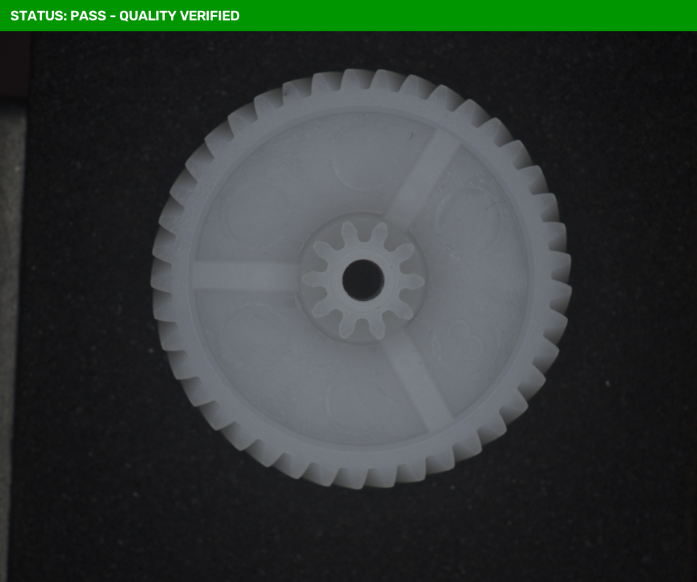
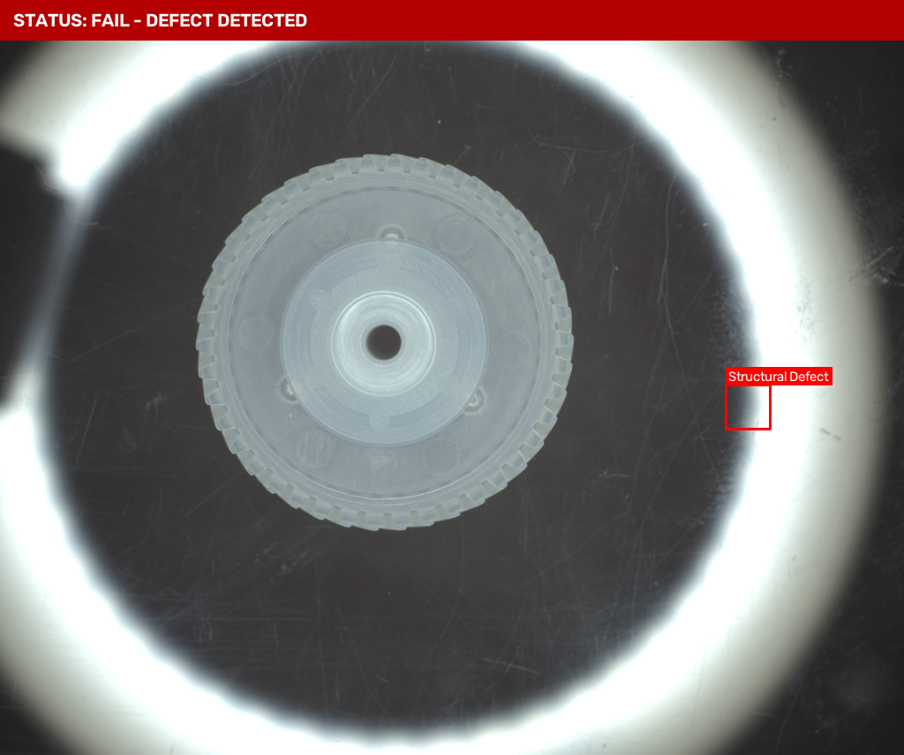
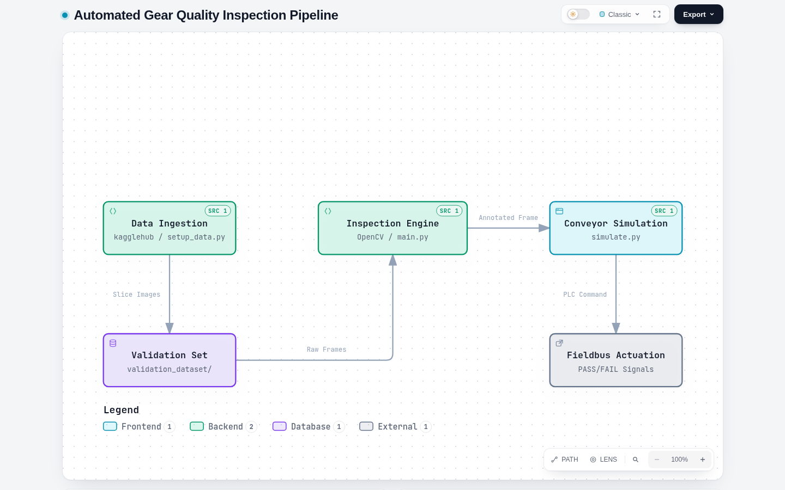

# Gear-Defect-Inspection-Using-OpenCV

Deterministic real-time computer vision system ("Digital Gatekeeper") inspecting plastic gears on a conveyor belt. Detects structural defects (such as broken teeth), highlights defect coordinates with bounding boxes, and outputs deterministic signals for PLC integration.

## Inspection Results & Visualization

### 1. Pass / Quality Verified
Gear normal passing tolerance gate with green status banner.


### 2. Fail / Structural Defect Detected
Gear failing tolerance gate with red warning banner, bounding box, and defect label.


## Prerequisites & Installation
1. Create virtual environment:
   ```bash
   python3 -m venv venv
   ```
2. Install dependencies:
   ```bash
   ./venv/bin/pip install -r requirements.txt
   ```

## Dataset Setup
Fetch the Kaggle dataset and slice the 20-image validation set (10 good, 10 defect):
```bash
./venv/bin/python setup_data.py
```
Images will be placed in `validation_dataset/good/` and `validation_dataset/defect/`.

## Execution
Run the inspection pipeline:
```bash
./venv/bin/python main.py
```
Live conveyor simulation:
```bash
./venv/bin/python simulate.py
```

## System Architecture (Archify)

Interactive HTML: [`architecture.html`](architecture.html) | Static preview:



## PLC Output Signals
- `[ PASS: QUALITY VERIFIED ]` -> Gear passes structural tolerance gate.
- `[ FAIL: STRUCTURAL DEFECT DETECTED ]` -> Gear fails tolerance gate, defect boxed in red.
